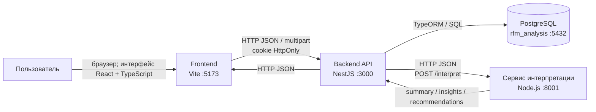
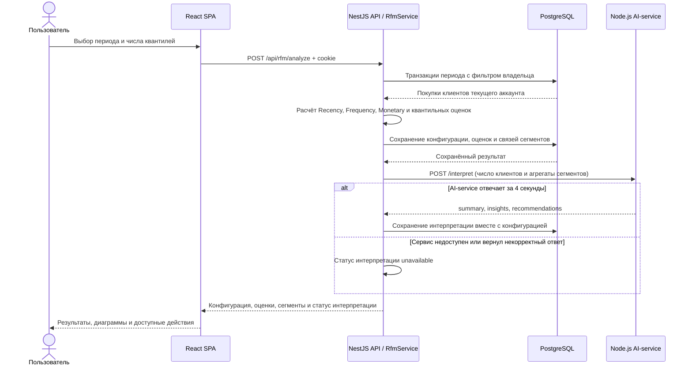

# Архитектура и взаимодействие компонентов

Схемы отражают фактическую структуру проекта и настройки локального запуска. Их можно использовать как основу для пояснительной записки и перерисовать в требуемом кафедрой формате плакатов A3. Порты приведены для локальной разработки и могут изменяться конфигурацией окружения.

## Компонентная схема



Frontend общается с backend через Axios с передачей credentials. JWT хранится в `HttpOnly` cookie и недоступен JavaScript-коду интерфейса. Backend аутентифицирует запрос, извлекает идентификатор пользователя и ограничивает этим владельцем операции чтения и записи клиентских данных и результатов. PostgreSQL не обращается напрямую к браузеру или AI-сервису.

## Размещение компонентов при локальном запуске

| Узел/процесс | Компонент | Адрес по умолчанию | Ответственность |
|---|---|---|---|
| Рабочая станция пользователя | Браузер и SPA React | `http://localhost:5173` | Ввод данных, импорт, настройка и просмотр анализа, визуализация и экспорт. |
| Backend-процесс | NestJS API | `http://127.0.0.1:3000/api` | Аутентификация, проверка запросов, разграничение доступа, импорт, RFM-расчёт и чтение/запись. |
| Backend-процесс | Сервис интерпретации Node.js | `http://127.0.0.1:8001` | Формирование экспертных наблюдений и рекомендаций по агрегатам сегментов; без прямого доступа к БД. |
| СУБД PostgreSQL | База `rfm_analysis` | `localhost:5432` | Пользователи, клиенты, транзакции, конфигурации анализов, сегменты и оценки RFM. |

Frontend, API и AI-сервис — отдельные процессы; PostgreSQL запускается отдельно как служба. В production должны использоваться заданные администратором адреса и защищённый HTTPS-канал для браузерного доступа. Указание HTTPS является требованием размещения, а не описанием текущего локального режима.

## Сценарий: вход и загрузка клиентских данных

```mermaid
sequenceDiagram
    actor User as Пользователь
    participant UI as React SPA
    participant API as NestJS API
    participant DB as PostgreSQL

    User->>UI: Ввод email и пароля
    UI->>API: POST /api/auth/login
    API->>DB: Проверка учётной записи и хеша пароля
    DB-->>API: Учётная запись
    API-->>UI: Публичный профиль + Set-Cookie HttpOnly
    User->>UI: Выбор CSV/Excel файла
    UI->>API: POST /api/data/import/{csv|excel}/preview
    API->>API: Проверка формата, строк и обязательных полей
    API-->>UI: Сводка и пример строк; без записи в БД
    UI-->>User: Показ результата предварительной проверки
    User->>UI: Подтверждение импорта
    UI->>API: POST /api/data/import/{csv|excel} + cookie
    API->>API: Проверка владельца и подготовка записей
    API->>DB: Атомарная запись клиентов и транзакций
    DB-->>API: Подтверждение транзакции
    API-->>UI: Число новых клиентов и транзакций
```

При ошибке валидации API возвращает `400` и сведения о строках, а импорт не записывает частичный набор. Предварительный просмотр не изменяет базу.

## Сценарий: RFM-анализ и интеллектуальная интерпретация



Недоступность AI-сервиса не отменяет уже сохранённый числовой результат. Тайм-аут вызова — 4 секунды. Сервис получает агрегаты сегментов, а не учётные данные пользователя и не подключается к PostgreSQL.

## Точки контроля доступа и отказа

- Защищённые API-маршруты требуют валидную сессию; данные SQL-запросов ограничиваются `userId` из JWT.
- Загрузка ограничена размером 10 МБ; DTO, заголовки файла и строки данных проверяются до сохранения.
- Запись импортируемого файла и результаты RFM сохраняются транзакциями PostgreSQL.
- Ошибки API возвращают идентификатор запроса и безопасное сообщение. Секреты и SQL-подробности не должны передаваться клиенту.
- Потеря соединения с PostgreSQL отражается в readiness endpoint `/api/health` статусом `503`.
- Потеря связи с AI-сервисом снижает доступность только текстовой интерпретации; числовые результаты анализа остаются доступными.

Связанные материалы: [REST-контракты API](API_CONTRACTS.md), [ER-схема БД](СХЕМА_БАЗЫ_ДАННЫХ.md), [план и отчёт тестирования](TEST_PLAN_AND_REPORT.md). Перед включением в пояснительную записку следует проверить подписи, визуально отрендерить схемы и при необходимости перенести их на A3.
