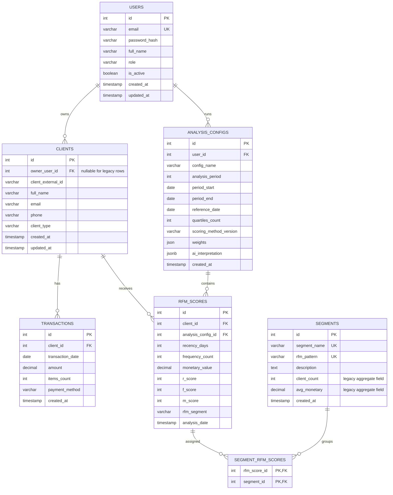

# Схема базы данных

Диаграмма составлена по `backend/database/init.sql`, миграциям `003_reliability_constraints.sql` и `004_client_data_ownership.sql`, а также TypeORM-сущностям. Она отражает логические отношения; типы обозначены обобщённо. Перед печатью необходимо отрендерить схему, проверить её читаемость и перенести на лист A3.

## ER-диаграмма

`UK` denotes a unique constraint; `PK` and `FK` are primary and foreign keys. `clients` has a unique key over `(owner_user_id, client_external_id)`, so the same external ID can belong to different accounts but not be duplicated within one account. Migration 004 makes application imports assign an owner and creates an index for the owner. Existing client rows allow a nullable owner at the schema level to preserve compatibility and `ON DELETE SET NULL`; the normal import flow assigns the authenticated user.

The key `uq_rfm_scores_analysis_client` guarantees at most one score for a client in a specific analysis. The join table `segment_rfm_scores` uses the pair `(rfm_score_id, segment_id)` as its primary key. A transaction belongs to one client; a score belongs to one client and one analysis configuration; configuration belongs to one user. Scores and transactions cascade with deletion of their parent. Analysis configuration cascades with user deletion; deleting a user sets the owner of their clients to null.

## Назначение таблиц

| Таблица | Назначение |
|---|---|
| `users` | Учётные записи, email и хеш пароля. |
| `clients` | Клиентские карточки в области аккаунта; `client_external_id` — внешний ключ из файла импорта, а не глобальный ID системы. |
| `transactions` | Покупки клиента с датой, суммой, числом товаров и способом оплаты. |
| `analysis_configs` | Параметры и временной интервал запуска RFM, версия метода, веса и JSON интерпретации. |
| `rfm_scores` | Измеренные R/F/M и присвоенные оценки по клиенту в одном запуске. |
| `segments` | Справочник названий/паттернов сегментов, общих для системы. |
| `segment_rfm_scores` | Связь оценок клиентов с сегментами; техническая таблица для отношения многие-ко-многим TypeORM. |

## Предварительная оценка нормализации

Базовые сущности разделены по предметному смыслу: аккаунт, клиент, покупка, конфигурация анализа, оценка и справочник сегментов имеют самостоятельные ключи. Для клиентов задана уникальность внешнего ID в пределах владельца; для оценок — уникальная пара «анализ + клиент». В транзакциях и клиентских данных не хранятся повторяющиеся массивы покупок. Эти признаки соответствуют нормализованной структуре основных отношений.

Нельзя без оговорок заявлять, что вся текущая схема доказанно приведена к 3НФ. В `segments` сохранены `client_count` и `avg_monetary`; агрегаты клиентского состава зависят от конкретного анализа, тогда как справочник сегмента разделяется между анализами. В `rfm_scores.rfm_segment` хранится паттерн, параллельно ссылаемый на справочник через `segment_rfm_scores`. Эти значения могут дублировать вычислимые или связываемые данные. Текущий код формирует сводки сегментов по оценкам и не использует поля агрегатов справочника как источник результата, но сами поля остаются в сущности и схеме.

Для пояснительной записки следует либо обосновать их как служебные/исторические поля, не участвующие в текущей функциональной зависимости, либо подготовить отдельное миграционное решение: хранить агрегаты сегмента в таблице результата с ключом анализа и сегмента, а идентичность сегмента связывать с оценкой строго одним согласованным способом. Перед изменением требуется проверить существующие данные, TypeORM-связи, миграции и API; этот документ не удаляет и не меняет поля.

## Требования для окончательного доказательства 3НФ

1. Зафиксировать предметные функциональные зависимости и кандидатные ключи каждой таблицы.
2. Проверить, являются ли `client_count`, `avg_monetary` актуальными полями или историческим наследием; определить их реальный детерминант.
3. Уточнить, нужна ли одновременно колонка `rfm_segment` и связь через `segment_rfm_scores`; проверить инвариант «одна оценка — один сегмент».
4. Сопоставить итоговую ER-модель с актуальным состоянием рабочей БД и TypeORM, а не только с начальным SQL-файлом.
5. Отразить подтверждённые ключи, кратности и действия при удалении в пояснительной записке.

Связанные проектные материалы: [архитектура и взаимодействие](ARCHITECTURE_AND_INTERACTION.md), [REST-контракты](API_CONTRACTS.md), [спецификация требований](REQUIREMENTS_AND_USE_CASES.md). SQL-источник и план миграций находятся в `backend/database/`.
